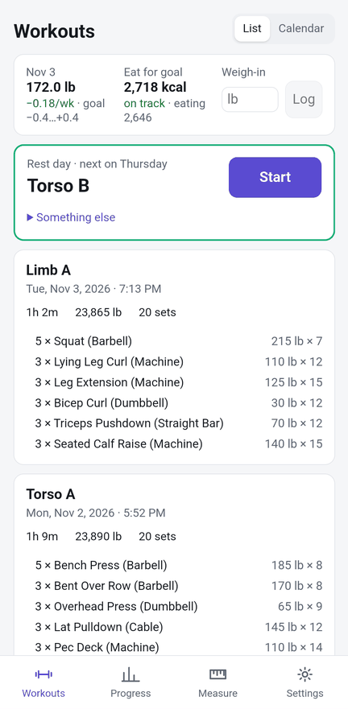
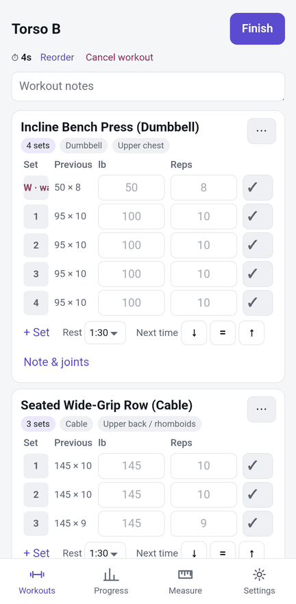
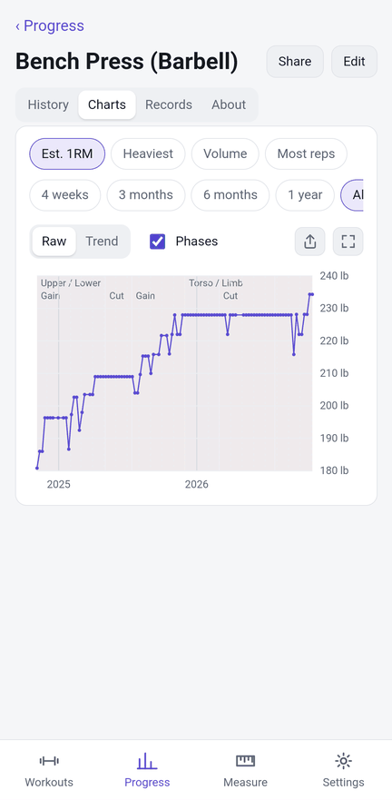
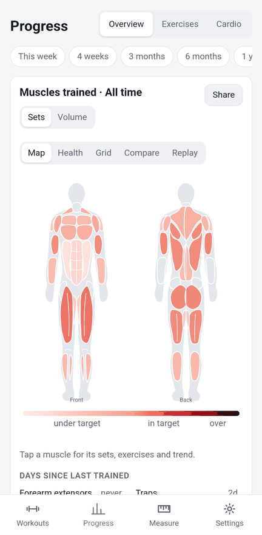
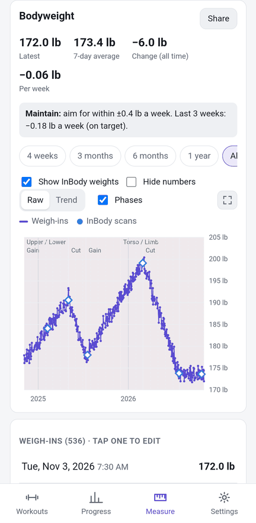
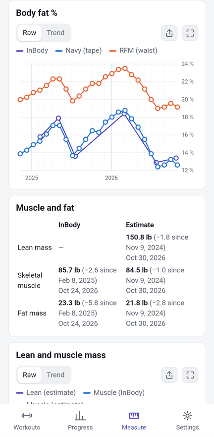
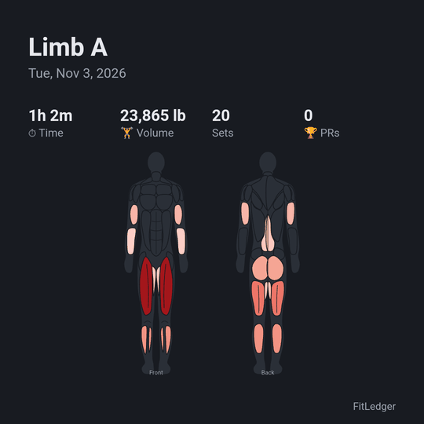

# FitLedger

The last fitness app I'll ever use. A personal tracker for lifting, cardio, bodyweight and body
composition that runs on your phone (Android) and desktop (Linux, Windows). No account, no server,
no subscription: your data stays on your device.

  
  
  

  
  
  

Screenshots use made-up demo data (`cargo run -p fitledger-core --example demo_data`).

## Install

**Android:** download `fitledger-<version>.apk` from the latest
[release](https://github.com/nkuehnle/FitLedger/releases), open it on your phone, and allow
installing from your browser or Files app when Android asks. New versions install over the old one,
and your data stays. (The APK is for 64-bit ARM phones, which is nearly every phone made since about
2017.)

**Coming from Strong:** export your data in Strong (Settings → Export data), then import the CSV in
FitLedger under **Settings → Import, export & backup**. Body measurements from Strong import too.

**Coming from Liftbook:** FitLedger installs as a new app. Restore your latest `.liftbook` backup
from **Settings → Import, export & backup → Restore…**.

**Desktop:** there are no desktop downloads yet; build it from source (see
[docs/DEVELOPMENT.md](docs/DEVELOPMENT.md)).

## Features

### Workouts
- **Strong-style live workout:** every set comes pre-filled from your last session of that
  workout. Tick sets in any order, swap or reorder exercises, and add workout or exercise notes.
- **Supersets** are shown with a colored bar and can be dragged as a unit.
- **Rest timer** with a chime and countdown buzz that work with the screen off or in another app,
  plus an ongoing notification with the rest countdown and the workout clock.
- **Suggested weights** fill the empty boxes. Progression hints (go up, repeat, or deload after
  repeated misses) and a next-time "up / hold / down" note for each exercise.
- **Templates, routines and starter programs**, with a weekly or custom-length schedule. The
  New workout list puts today's planned workout, or one you missed this week, first.
- **Perform again:** repeat any past workout. When you finish, the app asks whether to update the
  template.
- **Cardio:** runs, rides and rows with live pace (or speed, or /500 m), average heart rate,
  calories, a stopwatch, and cardio PRs.

### Progress
- **Per-exercise charts:** estimated 1RM, heaviest weight, volume and reps, with PR markers,
  rep maxes and PR history.
- **Body map heat map** of the muscles you trained, colored against weekly set targets, plus a
  muscle-by-week grid and a recovery view.
- **Training calendar**, streaks, workout duration and weekly minutes of cardio.
- **Program phases** (e.g. "Upper / Lower", "Cut") drawn as bands behind every chart.

### Body
- **Bodyweight** with a 7-day average, change per week, a goal (cut, maintain or gain) with a
  weekly target, and weigh-in reminders on the days you choose.
- **Body parts:** log any measurement (waist, neck, arms, …) and chart it.
- **Body composition:** InBody scans by hand, from a CSV, or **read straight from a photo of an
  InBody 580 result sheet** with on-device OCR. Body fat, lean mass and fat mass are charted
  alongside US Navy and relative-fat-mass tape estimates.
- **Calories and protein (optional):** energy balance from your weight trend and an adaptive
  TDEE estimate.

### Charts
- **Raw or Trend** (LOESS smoothing). Your choice is remembered. Raw shows every data point.
- **Full screen,** turned sideways on a phone. Drag along the line to read the date and value.

### Sharing
- **Share any chart, workout, exercise or body map as an image:** square (1080×1080) or story
  (1080×1920), dark or light, with an option to hide exact numbers.
- **Save to Photos** or use the Android share sheet (Instagram Stories, Discord, Messages, …).

### Watches and health apps
- **Health Connect** sync on Android (Garmin Connect, Fitbit, Oura, … write to it): weight,
  workouts, heart rate, sleep, resting heart rate, HRV and steps.
- **Garmin .fit file import** on any platform.
- Heart rate on the workout screen and a recovery line on Today.

### Your data
- **Offline first.** The only network use is a one-time 12 MB download of the InBody sheet reader
  the first time you read a sheet.
- **Backups:** manual backups, a weekly automatic backup to `Download/FitLedger` (newest 4 kept),
  and Android's own account backup, which restores your data on a new phone.
- **Exports:** Strong-format workout CSV, bodyweight, InBody, measurements, diet, and a full JSON
  export.
- **kg or lb**, light or dark theme.

## License

[PolyForm Noncommercial 1.0.0](LICENSE.md): free to use, change and share for any non-commercial
purpose (personal use, hobby projects, research, education, charities). Commercial use needs
permission from the author.

## Credits

InBody sheet reading uses the [Ocrs](https://github.com/robertknight/ocrs) engine. Its models
are trained on Google Research's HierText dataset and licensed CC BY-SA 4.0 (see
[crates/ocr/models/README.md](crates/ocr/models/README.md)).

For building, testing and releasing, see [docs/DEVELOPMENT.md](docs/DEVELOPMENT.md).
